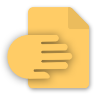

English | [中文](README.md)

    
    <h1>Local Hand</h1>

 

A simple, cross-platform LAN transmission tool built on Flutter.

## Function

1. Automatic LAN discovery with a reliable TCP connection handshake
2. Send and receive files and text messages, with multi-file selection
3. End-to-end encryption: ECDH P-256 key agreement, AES-256-GCM for messages and AES-256-CTR + HMAC-SHA256 for file chunks
4. QR pairing: show or scan a QR code, one-time pairing code, encrypted session starts automatically
5. Open the file (bring up the media player or select another pop-up window)
6. Message long press menu (copy text, copy full path, open file location); right-click menu on desktop
7. Received files are scanned into the media library on Android, so other apps and file managers see them immediately; open the receive folder in one tap
8. Desktop experience: drag files into the window to send them (multiple files supported), press Enter to send, centered layout on wide windows

## Security

- Every connection uses fresh ephemeral ECDH keys; session keys live only in memory and are discarded on disconnect.
- Files are streamed in encrypted 256 KB frames. Chunk order, chunk count and file metadata are authenticated, so tampering, reordering or truncation is rejected. Encryption runs on a background isolate so large transfers keep the UI responsive.
- File names are encrypted too, and the receiver sanitizes them so peers cannot write outside the receive folder.
- QR pairing uses a random one-time code; reopening the pairing sheet refreshes it.

## Permissions

- Android: "All files access" is required to save received files into the system Downloads folder and refresh the media library; camera access is used for QR scanning.
- iOS: camera (QR scanning) and local network (device discovery) permissions are required.

## Installation

### Windows or Android
Download the compiled version of [Releases](https://github.com/stand114514/Local-Hand/releases)

Currently, only Android and Windows apps are available, please build your own for other platforms, and developers do not have device testing

## License

This project is licensed under the MIT license.

## Thanks

- [Flutter](https://docs.flutter.cn/) - Google's mobile UI framework.